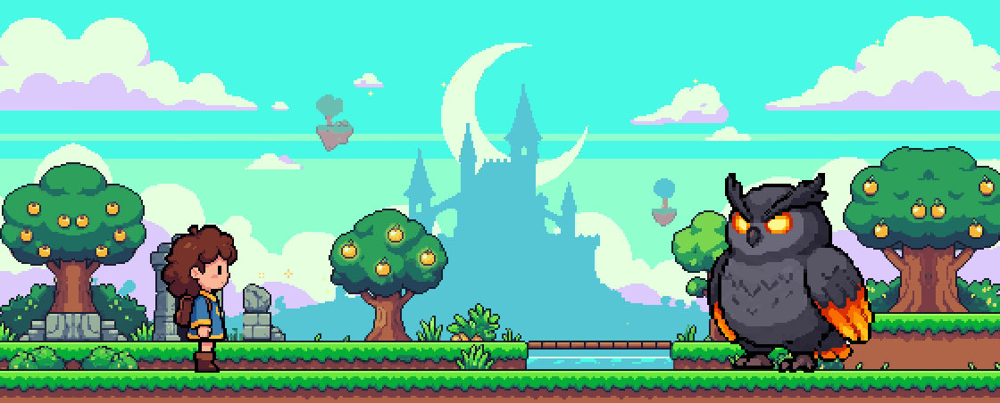

[English](README.md) · [Português](README.pt-BR.md) · [Español](README.es.md) · [Français](README.fr.md) · **Deutsch** · [中文](README.zh-CN.md) · [日本語](README.ja.md) · [한국어](README.ko.md)

<p align="center"></p>

# 🌙 Die Chroniken von Lua · *As Crônicas de Lua*

Ein Pixel-Art-RPG-Mod für Claude Code. Jedes Tool ist ein Monster, dein Kontextfenster ist ein Rucksack, dein Nutzungslimit ist Mana, und Lua, eine kleine Mondmagierin, stellt sich ihnen allen, während Claude arbeitet. Bosskämpfe, XP, Level und ein Bestiarium. Technisch gesehen programmierst du immer noch.


## Was ist das?
Ein Streifen direkt über dem Nachrichtenfeld. Während Claude arbeitet, wandert Lua durch einen Wald mit Parallax-Effekt; jedes Mal, wenn Claude ein Tool benutzt, taucht ein Monster auf und sie kämpft dagegen. Hinter dem Spiel ist der Streifen ein ehrliches Dashboard deiner Sitzung: wie warm der Prompt-Cache noch ist, wie viel vom Limit deines Plans übrig ist und wie voll das Kontextfenster ist.


## Installation
Tippe in einer Claude-Code-Sitzung:

```text
/plugin install cronicas-de-lua --marketplace geoaltran/cronicas-de-lua-claude-code
```

Antworte mit `y`, um den Marketplace hinzuzufügen, und wähle dann einen Geltungsbereich. Der Streifen erscheint über dem Nachrichtenfeld.

Benötigt ein aktuelles Claude Code mit Mod-Unterstützung (gebaut und getestet mit 2.1.330).

## Wo es läuft
| Oberfläche | Was du bekommst |
|---|---|
| **Claude-Desktop-App (Tab „Code“)** | Das ganze Spiel: animierte Szene, Tooltips beim Überfahren mit der Maus, klickbare Pixel-Art-Buttons, das Buch-Panel. |
| **VS Code** | Dieselbe animierte Szene; die Buttons stehen in einer Reihe darunter (VS Code kennt kein Hover innerhalb der Zeichnung). |
| **Terminal** | Eine kompakte Textversion mit farbigen Balken und Emojis. |
| **Mobile App** | Noch nicht: Die App zeichnet die Streifen von Mods derzeit nicht über Remote Control. |

## Die Balken
| Balken | Bedeutet |
|---|---|
| **Mondlicht** (blasses Gold) | Wie warm der Prompt-Cache noch ist (Zeit seit der letzten Antwort im Verhältnis zur Lebensdauer des Caches). Ein Mond am Himmel nimmt mit ihm ab. **Neumond** = Lua fällt in Ohnmacht und die nächste Nachricht kostet mehr (der Cache ist kalt). |
| **Sternenmana** | Was vom 5-Stunden-Limit deines Plans übrig ist (das 7-Tage-Limit steht im Tooltip). |
| **Rucksack** | Wie viel vom Kontextfenster belegt ist. Ab 80 % wackelt der Rucksack und schlägt vor, aufzuräumen (zu komprimieren). |
| **XP / Level** | Steigt, während du arbeitest. Alle 2 Level glänzen Luas Zauberstab und Gewand ein bisschen mehr. |

## Die Buttons
| Button | Macht |
|---|---|
| 🏮 **Nachtwache** | Hält den Cache warm, indem sie kurz vor dem Erlöschen des Mondlichts eine winzige Nachricht schickt (höchstens 6-mal und nur, während du weg bist). **Standardmäßig aus: Sie verbraucht das Limit deines Plans.** |
| 🎒 **Rucksack** | Bietet an, das Gespräch zu komprimieren (wie `/compact`), mit Bestätigung. |
| 🚩 **Banner** | Bittet Claude um eine Zusammenfassung der Mission, damit du in einer neuen Sitzung weitermachen kannst. |
| 📖 **Buch** | Öffnet Luas Buch: ihr Charakterblatt, das Bestiarium der besiegten Bosse, das Trophäenregal und das Grimoire (Claudes Tools als Zauber). |

## Was im Spiel passiert
| Echtes Ereignis | Im Spiel |
|---|---|
| Leerlauf, zwischen Aufgaben | Lua wandert oder steht da, atmet und blinzelt |
| Ein Tool startet | Ein Monster erscheint, ein „!“ über Lua, sie wirft einen Stern |
| Das Tool klappt | Trefferpause, das Monster blitzt auf, weicht zurück und zerplatzt in Sterne; Schadenszahl |
| Ein langsames Tool | Lua kanalisiert mit einem magischen Kreis zu ihren Füßen |
| Das Tool schlägt fehl | Das Monster schlägt zurück; Lua blinkt rot (nur optisch) |
| Ein später behobener Fehler | Elite (Obsidian-Golem); wenn er fällt, bleibt eine Trophäe fürs Regal |
| Eine Aufgabenliste wird erstellt, oder alle 12 Kämpfe | **Boss**: Leben in Blöcken, einer pro Aufgabe. Normale Treffer prallen an seinem **Schild** ab (Lua kratzt sich am Kopf ❓💧); eine erledigte Aufgabe räumt einen Block ab; die letzte ist ein **KRITISCHER** Treffer. Der Boss fällt mit einer wiedergefundenen Seite (x/10) und einem Levelaufstieg |



Monster nach Tool: Dateien lesen → Vespera · Code bearbeiten → Relojoeiro / Sir Solis · Terminal → Ignis · Web → Leviatã / Nébula · Integrationen (MCP) → Rei Espelho · Subagenten → Klone von Dama Penumbra. Die Bosse kommen der Reihe nach, jeder mit einer Seite der Chroniken, bis zu Malakor, danach Neues Spiel+.

## Befehle
`/cronicas` zeigt Luas Übersicht. Die nützlichsten: `/cronicas ruler` und `/cronicas width <px>` (Breite kalibrieren), `/cronicas boss` und `/cronicas hit` (einen Bosskampf ausprobieren), `/cronicas surfaces` (wo die Sitzung gerade gezeichnet wird), `/cronicas language` (die Spielsprache wählen). Der Spieltext ist vorerst auf Portugiesisch; weitere Sprachen sind unterwegs.

## Lizenz
- **Code** (Python-Skripte, `mod/`): **MIT**, siehe [`LICENSE`](LICENSE).
- **Grafik und Figuren** (alles in `assets/`, die im Mod eingebettete Grafik, die Sounds und die Vorschauen): **© 2026 George Altran (@geoaltran), [CC BY-NC 4.0](LICENSE-ART)**. Teile sie, remixe sie, mach Fan-Art: Nenne einfach **„Art by George Altran (@geoaltran)“** mit einem Link. **Keine kommerzielle Nutzung** ohne Erlaubnis; eine kommerzielle Lizenz gibt es auf Anfrage.
- **Schriften**: Silkscreen und Pixelify Sans, **SIL Open Font License 1.1** (die Lizenzdateien liegen daneben).

Rechtlich verbindlich ist nur der englische Lizenztext. Alle Credits in [`CREDITS.md`](CREDITS.md).
