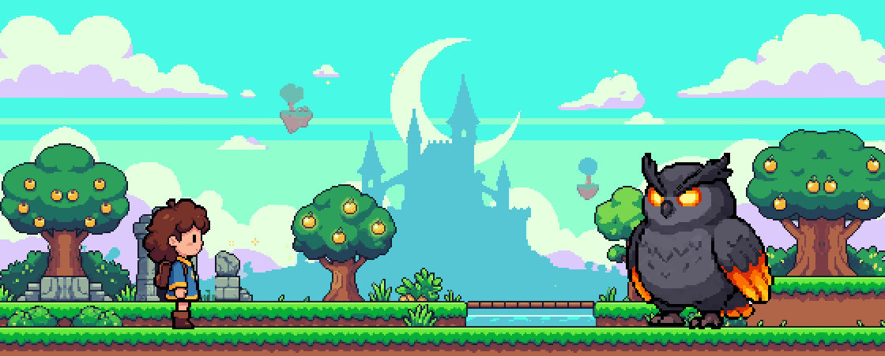

[English](README.md) · [Português](README.pt-BR.md) · [Español](README.es.md) · **Français** · [Deutsch](README.de.md) · [中文](README.zh-CN.md) · [日本語](README.ja.md) · [한국어](README.ko.md)

<p align="center"></p>

# 🌙 Les Chroniques de Lua · *As Crônicas de Lua*

Un mod RPG en pixel art pour Claude Code. Chaque outil est un monstre, ta fenêtre de contexte est un sac à dos, ta limite d'utilisation est du mana, et Lua, une petite mage lunaire, les affronte tous pendant que Claude travaille. Boss, XP, niveaux et bestiaire. Techniquement, tu es toujours en train de coder.


## C'est quoi
Une bande juste au-dessus de la zone de message. Pendant que Claude travaille, Lua se promène dans une forêt en parallaxe ; chaque fois que Claude utilise un outil, un monstre surgit et elle le combat. Derrière le jeu, la bande est un tableau de bord honnête de ta session : à quel point le cache du prompt est encore chaud, ce qu'il reste de la limite de ton forfait et à quel point la fenêtre de contexte est remplie.


## Installation
Dans une session Claude Code, tape :

```text
/plugin install cronicas-de-lua --marketplace geoaltran/cronicas-de-lua-claude-code
```

Réponds `y` pour ajouter la marketplace, puis choisis une portée. La bande apparaît au-dessus de la zone de message.

Nécessite une version récente de Claude Code compatible avec les mods (créé et testé sur la 2.1.330).

Le mod lance seulement deux commandes en lecture seule sur votre machine : `ps` (pour savoir quand l'app a redémarré, à cause de l'intro) et, sur macOS, `defaults read -g AppleLanguages` (la langue du système).

## Où ça tourne
| Surface | Ce que tu obtiens |
|---|---|
| **App de bureau Claude (onglet Code)** | Le jeu complet : scène animée, infobulles au survol, boutons en pixel art cliquables, le panneau du Livre. |
| **VS Code** | La même scène animée ; les boutons sont sur une ligne en dessous (VS Code ne gère pas le survol dans le dessin). |
| **Terminal** | Une version compacte en texte, avec des barres colorées et des emojis. |
| **App mobile** | Pas encore : l'app ne dessine pas les bandes des mods via Remote Control pour l'instant. |

## Les barres
| Barre | Signification |
|---|---|
| **Clair de Lune** (or pâle) | À quel point le cache du prompt est encore chaud (temps depuis la dernière réponse par rapport à la durée de vie du cache). Une lune dans le ciel décroît avec lui. **Nouvelle lune** = Lua s'évanouit et le prochain message coûte plus cher (le cache est froid). |
| **Mana Stellaire** | Ce qu'il reste de la limite de 5 heures de ton forfait (celle de 7 jours dans l'infobulle). |
| **Sac à dos** | La part de la fenêtre de contexte déjà utilisée. Au-delà de 80 %, le sac tremble et propose de faire du rangement (compacter). |
| **XP / Niveau** | Monte à mesure que tu travailles. Tous les 2 niveaux, la baguette et la tenue de Lua brillent un peu plus. |

## Les boutons
| Bouton | Fait |
|---|---|
| 🏮 **Veille** | Garde le cache au chaud en envoyant un tout petit message juste avant que le clair de lune s'éteigne (6 fois au maximum, et seulement pendant ton absence). **Éteinte par défaut : elle consomme la limite de ton forfait.** |
| 🎒 **Sac à dos** | Propose de compacter la conversation (comme `/compact`), avec confirmation. |
| 🚩 **Étendard** | Demande à Claude un résumé de la mission pour continuer dans une nouvelle session. |
| 📖 **Livre** | Ouvre le Livre de Lua : sa fiche, le bestiaire des boss vaincus, l'étagère à trophées et le grimoire (les outils de Claude en guise de sorts). |

## Ce qui se passe dans le jeu
| Événement réel | Dans le jeu |
|---|---|
| Au repos, entre deux tâches | Lua marche, ou reste immobile, respire et cligne des yeux |
| Un outil démarre | Un monstre entre, un « ! » au-dessus de Lua, elle lance une étoile |
| L'outil réussit | Pause d'impact, le monstre clignote, recule et éclate en étoiles ; chiffre de dégâts |
| Un outil lent | Lua canalise avec un cercle magique à ses pieds |
| L'outil échoue | Le monstre contre-attaque ; Lua clignote en rouge (purement visuel) |
| Une erreur corrigée plus tard | Élite (Golem d'Obsidienne) ; en tombant, il laisse un trophée pour l'étagère |
| Une liste de tâches est créée, ou tous les 12 combats | **Boss** : vie en blocs, un par tâche. Les coups ordinaires rebondissent sur son **bouclier** (Lua se gratte la tête ❓💧) ; une tâche terminée fait tomber un bloc ; la dernière est un coup **CRITIQUE**. Le boss tombe avec une page retrouvée (x/10) et un niveau en plus |



Monstres par outil : lire des fichiers → Vespera · modifier du code → Horloger / Sir Solis · terminal → Ignis · web → Léviathan / Nébula · intégrations (MCP) → Roi Miroir · sous-agents → clones de la Dame Pénombre. Les boss arrivent dans l'ordre, une page des Chroniques chacun, jusqu'à Malakor, puis Nouvelle partie+.

## Commandes
`/cronicas` affiche le résumé de Lua. Les plus utiles : `/cronicas ruler` et `/cronicas width <px>` (calibrer la largeur), `/cronicas boss` et `/cronicas hit` (tester un combat de boss), `/cronicas surfaces` (où la session est dessinée), `/cronicas language` (choisir la langue du jeu). Le jeu parle anglais, portugais, espagnol, français et allemand (il suit la langue du système ; `/cronicas language` la change) ; le chinois, le japonais et le coréen arrivent bientôt.

## Licence
- **Code** (scripts Python, `mod/`) : **MIT**, voir [`LICENSE`](LICENSE).
- **Art et personnages** (tout ce qui se trouve dans `assets/`, l'art intégré au mod, les sons et les aperçus) : **© 2026 George Altran (@geoaltran), [CC BY-NC 4.0](LICENSE-ART)**. Partage-le, remixe-le, fais du fan art : il suffit de créditer **« Art by George Altran (@geoaltran) »** avec un lien. **Pas d'usage commercial** sans autorisation ; une licence commerciale est disponible sur demande.
- **Polices** : Silkscreen et Pixelify Sans, **SIL Open Font License 1.1** (les licences sont à côté d'elles).

Seul le texte juridique de la licence en anglais fait foi. Crédits complets dans [`CREDITS.md`](CREDITS.md).
