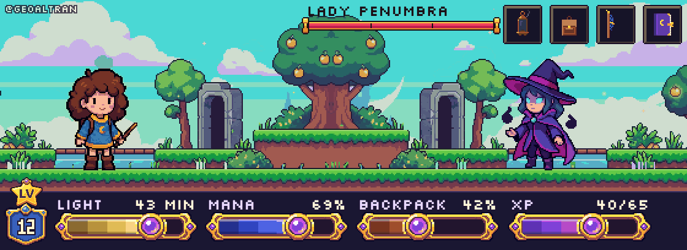

[English](README.md) · [Português](README.pt-BR.md) · [Español](README.es.md) · [Français](README.fr.md) · [Deutsch](README.de.md) · [中文](README.zh-CN.md) · **日本語** · [한국어](README.ko.md)

<p align="center"></p>

# 🌙 Lua クロニクル · *As Crônicas de Lua*

<p align="center"><b>Claude Code、でも RPG。</b><br>ツールを呼ぶたびにモンスター。ToDo リストはボス戦。それでも、ちゃんとコーディング中です。</p>

<p align="center">
  <a href="https://github.com/geoaltran/cronicas-de-lua-claude-code/blob/main/CHANGELOG.md"></a>
  <a href="https://github.com/geoaltran/cronicas-de-lua-claude-code/stargazers"></a>
  
  
  
</p>

<p align="center"><a href="#インストール">インストール</a> · <a href="#コマンド">コマンド</a> · <a href="CHANGELOG.md">更新履歴</a> · <a href="https://github.com/geoaltran/cronicas-de-lua-claude-code/issues/new?title=Idea:%20">ボスやバイオームを提案</a> · <a href="https://github.com/geoaltran/cronicas-de-lua-claude-code/issues/new?title=Bug:%20">不具合を報告</a></p>


Lua はメッセージ入力欄のすぐ上に住む、小さな月の魔法使いです。Claude がファイルを読むと Vespera と戦い、コードを編集すると時計職人が現れ、時間のかかるコマンドでは呪文を溜め、ツールが失敗すると吹き飛ばされます。ToDo リストを作るとボスが登場。タスクを 1 つ終えるたびに体力のブロックが 1 つ砕け、最後の 1 つは**会心の一撃**。Claude を待つ数分間の、小さな冒険です。

- **ツールを呼ぶたびにバトル**：読み込み、編集、ターミナル、Web、MCP、サブエージェントにそれぞれのモンスター。
- **ToDo リストはボス戦**：ブロック状の体力、シールド、会心の一撃を持つ 10 体のボス。
- **パララックスで動く 9 つのバイオーム**：ボスごとに 1 つ。満月の海から火山、日食まで。
- **正直な HUD**：月光はプロンプトキャッシュ、マナはプランの上限、リュックはコンテキストウィンドウ。
- **経験値、レベル、Lua の本**：図鑑、トロフィー棚（直したエラーがトロフィーに）、Claude のツールの魔導書。
- **8 言語**：English, Português, Español, Français, Deutsch, 中文, 日本語, 한국어。

## どんなもの？
メッセージ入力欄のすぐ上に表示される帯です。Claude が作業しているあいだ、Lua はパララックスで動く 9 つのバイオームを旅し、Claude がツールを使うたびにモンスターが現れて戦います。ゲームの裏側では、この帯がセッションの状態を正直に映すダッシュボードになっています。プロンプトキャッシュがどれだけ温かいか、プランの上限があとどれだけ残っているか、コンテキストウィンドウがどれだけ埋まっているか。


## インストール
Claude Code のセッションで次のように入力します。

```text
/plugin install cronicas-de-lua --marketplace geoaltran/cronicas-de-lua-claude-code
```

`y` と答えてマーケットプレイスを追加し、スコープを選んでください。メッセージ入力欄の上に帯が表示されます。

Mod に対応した最新の Claude Code が必要です（2.1.331 で開発・テスト）。

この Mod があなたのマシンで実行するのは、読み取り専用の 2 つのコマンドだけです：`ps`（アプリの再起動を検知してオープニングを出すため）と、macOS では `defaults read -g AppleLanguages`（システムの言語）。

**アップデート。** 1日に1回、最初のセッションで、Mod はこのリポジトリに公開されているバージョン番号も読みます（GitHub 上の公開ファイル）。あなたや会話についての情報は何も送られず、勝手にダウンロードやインストールもしません。新しいバージョンが出ると、本のボタンに小さな星が付き、吹き出しでお知らせします。更新するには `/plugin marketplace update cronicas-de-lua`、続けて `/plugin update cronicas-de-lua@cronicas-de-lua` と入力し、新しいセッションを開いてください。`/cronicas updates off` で確認をオフにできます（`CLAUDE_CODE_DISABLE_NONESSENTIAL_TRAFFIC` が設定されているときもオフのままです）。アップデートを自動で受け取りたい場合は、Claude Code 自体にマーケットプレイスの自動更新オプションがあります。

## 動作する場所
| 画面 | できること |
|---|---|
| **Claude デスクトップアプリ（Code タブ）** | フル版のゲーム：アニメーションするシーン、マウスを乗せると出るツールチップ、クリックできるピクセルアートのボタン、「本」のパネル。 |
| **VS Code** | 同じアニメーションのシーン。ボタンはその下に一列で並びます（VS Code では絵の中のホバーが使えません）。 |
| **ターミナル** | 色つきのバーと絵文字を使ったコンパクトなテキスト版。 |
| **モバイルアプリ** | まだ未対応：現在、アプリは Remote Control 経由では Mod の帯を描画しません。 |

## バー
| バー | 意味 |
|---|---|
| **月明かり**（淡い金色） | プロンプトキャッシュがまだどれだけ温かいか（最後の返答からの経過時間とキャッシュの寿命の比）。空の月もそれに合わせて欠けていきます。**新月** = Lua が眠ってしまい、次のメッセージは割高に（キャッシュが冷えています）。 |
| **星のマナ** | プランの 5 時間上限の残り（7 日間の上限はツールチップに表示）。 |
| **リュック** | コンテキストウィンドウの使用量。80% を超えるとリュックが震えて、片づけ（会話の圧縮）を勧めます。 |
| **経験値 / レベル** | 作業するほど上がります。2 レベルごとに、Lua の杖と衣装が少しずつ輝きを増します。 |

## ボタン
| ボタン | 動作 |
|---|---|
| 🏮&nbsp;**夜番** | 月明かりが消える直前にごく短いメッセージを送って、キャッシュを温かいまま保ちます（最大 6 回、あなたが離席しているあいだだけ）。**初期設定はオフ：プランの上限を消費します。** |
| 🎒&nbsp;**リュック** | 会話の圧縮（`/compact` と同様）を、確認つきで提案します。 |
| 🚩&nbsp;**旗** | 新しいセッションで続きができるよう、Claude にミッションのまとめを書いてもらいます。 |
| 📖&nbsp;**本** | Lua の本を開きます。キャラクターシート、旅の地図（訪れたバイオーム）、倒したボスの図鑑、トロフィー棚、魔導書（Claude のツールを呪文として）、そして `/cronicas` の全コマンドを並べたコマンドのページ（ここの説明へのリンク付き）。新しいバージョンが出ると本に小さな星が光り、コマンドのページに更新のしかたが出ます。 |


## ゲームの中で起きること
| 実際の出来事 | ゲームでは |
|---|---|
| 待機中、タスクの合間 | Lua が歩く、または立ったまま呼吸してまばたき |
| ツールが動き出す | モンスター登場、Lua の頭上に「!」、星の魔法を放つ |
| ツールが成功 | ヒットストップ、モンスターが白く光って後ずさり、星になってはじける。ダメージの数字 |
| ツールに時間がかかる | Lua が足元に魔法陣を出して詠唱 |
| ツールが失敗 | モンスターの反撃。Lua が赤く点滅（見た目だけ） |
| あとで直したエラー | エリート（黒曜石のゴーレム）。倒れると棚に飾るトロフィーを残します |
| タスクリストを作ったとき、または 12 戦ごと | **ボス**：体力はブロック制で、タスク 1 つにつき 1 ブロック。ふつうの攻撃は**盾**に弾かれ（Lua は頭をかく ❓💧）、タスクを 1 つ終えると 1 ブロック減り、最後の 1 つは**クリティカル**。ボスを倒すとクロニクルのページ（x/10）を取り戻してレベルアップし、Lua は次のバイオームへ |




ツールごとのモンスター：ファイルを読む → Vespera · コードを編集 → 時計職人 / Sir Solis · ターミナル → Ignis · Web → リヴァイアサン / Nébula · 外部連携（MCP）→ 鏡の王 · サブエージェント → 半影の貴婦人の分身。ボスは順番に登場し、それぞれがクロニクルの 1 ページ。最後の Malakor を倒すと「強くてニューゲーム」へ。ときどき（ふつうの戦いのおよそ 4 回に 1 回）、今のページのボスが代わりに登場して、この先を予告します。

## バイオーム
Lunária には 9 つのバイオームがあり、旅の区切りごとに 1 つずつ、それぞれ決まった時間帯と専用のアニメーションがあります。森（Vespera と半影の貴婦人）、遺跡（黒曜石のゴーレム）、海（リヴァイアサン）、火山（Ignis）、時計塔（時計職人）、夜明け（Sir Solis）、ガラスの城（鏡の王）、星空（Nébula）、日食（Malakor）。波と回る灯台、脈打つ溶岩、回る歯車、日の光、鏡を走る反射、流れ星、そして場所ごとのパーティクル。


バイオームのボスを倒すと**ステージ切り替え**。Lua は画面の端から歩いて出ていき、画面が暗転すると、ピクセルアートのページタイトルとともに次のバイオームへ入ってきます。


## コマンド
ふつうのメッセージと同じように Claude の入力欄に打ち込みます。返事はあなたにだけ表示され、Claude には何も届かず、プランの上限も使いません。どのサブコマンドもポルトガル語の名前（`regua`、`largura`、`chefao`、`golpe`…）でも動きます。

| コマンド | できること |
|---|---|
| <code>/cronicas</code> | Lua のまとめ：レベル、経験値、取り戻したページ（x/10）、最新のトロフィー、帯の設定。すべてのコマンドの一覧も出ます。 |
| <code>/cronicas&nbsp;language&nbsp;[code]</code> | ゲームの言語を一覧表示、または切り替え：`en`、`pt-BR`、`es`、`fr`、`de`、`zh`、`ja`、`ko`（`auto` でシステムの言語に戻ります）。 |
| <code>/cronicas&nbsp;updates&nbsp;[check&#124;off&#124;on]</code> | いまのバージョンと新しいバージョンの有無、更新のしかたを表示します。`check` でいますぐ確認、`off` / `on` で毎日の確認をオフ・オンにします。 |
| <code>/cronicas&nbsp;ruler</code> | シーンの下に定規を出して帯の幅を測ります。もう一度打つと消えます。 |
| <code>/cronicas&nbsp;width&nbsp;&lt;px&gt;</code> | 定規の右端で欠けずに見える最後の数字で幅を合わせます（例：`/cronicas width 752`）。 |
| <code>/cronicas&nbsp;scale&nbsp;1&#124;2&#124;3</code> | シーンのピクセルの大きさ：1x、2x、3x。 |
| <code>/cronicas&nbsp;intro</code> | オープニングをいますぐ再生（クリックでスキップ）。`intro off` / `intro on` で自動再生（その日最初のセッション）をオフ／オン。 |
| <code>/cronicas&nbsp;surfaces</code> | このセッションがどこに描かれているかを表示（デスクトップアプリ、VS Code、ターミナル、スマホ）。 |
| <code>/cronicas&nbsp;boss&nbsp;[name]</code> | 旅の次のボス、または指定したボス（`vespera`、`ignis`、`malakor`…）を呼び、シーンはそのボスのバイオームに移ります。`/cronicas boss list` は盾を持ったタスクリストのボス。 |
| <code>/cronicas&nbsp;hit</code> | 場にいるボスを攻撃。タスクリストのボスならタスクを 1 つ完了。最後の一撃はクリティカル。 |
| <code>/cronicas&nbsp;elite</code> | 次のふつうの戦いが、トロフィーを持ったエリート（黒曜石のゴーレム）になります。 |
| <code>/cronicas&nbsp;walk&nbsp;[秒]</code> | ルナが今のバイオームを数秒歩き（標準 8 秒、最大 120 秒）、レイヤーがループして流れるのを見せてから、止まって息をします。 |
| <code>/cronicas&nbsp;stage&nbsp;[バイオーム]</code> | 景色を見るためだけのステージ移動：ルナが歩いて出ていき、次のバイオーム（または指定した `sea`、`volcano`、`eclipse`…）がタイトルとともに現れ、また歩いて入ってきます。ページは数えません。 |
| <code>/cronicas&nbsp;vigil</code> | 月明かりを残りわずかにして、夜番の動きを見られます（ランタンが灯っていれば、本物の短いメッセージを送ります）。 |
| <code>/cronicas&nbsp;new-moon</code> | Claude の次の返答まで新月（冷えたキャッシュ）を再現します。 |

⚠️ テスト用のコマンド（`boss`、`hit`、`elite`）は本当にカウントされます。こうして倒したボスでもページとレベルが手に入ります。

ゲーム内のテキストは英語・ポルトガル語・スペイン語・フランス語・ドイツ語・中国語・日本語・韓国語に対応しています（システムの言語に合わせて切り替わり、`/cronicas language` で変更できます）。

## ライセンス
- **コード**（Python スクリプト、`mod/`）：**MIT**。[`LICENSE`](LICENSE) を参照。
- **アートとキャラクター**（`assets/` のすべて、Mod に埋め込まれたアート、サウンド、プレビュー）：**© 2026 George Altran (@geoaltran)、[CC BY-NC 4.0](LICENSE-ART)**。共有、リミックス、ファンアートは大歓迎です。リンクとともに **「Art by George Altran (@geoaltran)」** とクレジットしてください。許可なく**商用利用はできません**。商用ライセンスはご相談ください。
- **フォント**：Silkscreen、Pixelify Sans、Fusion Pixel Font（中国語・日本語・韓国語）、**SIL Open Font License 1.1**（ライセンスファイルはフォントと同じ場所にあります）。

法的に有効なのは英語のライセンス本文です。クレジットの全文は [`CREDITS.md`](CREDITS.md) にあります。
