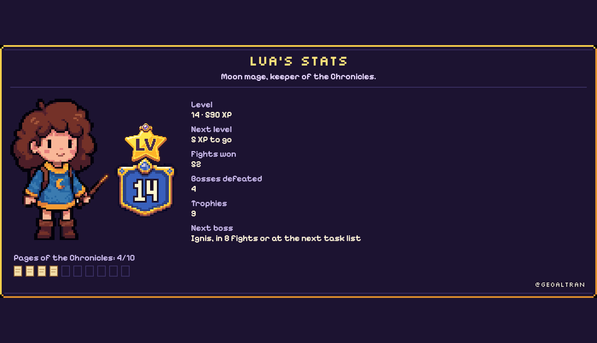

[English](README.md) · [Português](README.pt-BR.md) · [Español](README.es.md) · [Français](README.fr.md) · [Deutsch](README.de.md) · [中文](README.zh-CN.md) · [日本語](README.ja.md) · **한국어**

<p align="center"></p>

# 🌙 Lua 연대기 · *As Crônicas de Lua*

<p align="center"><b>Claude Code, 그런데 RPG.</b><br>도구를 호출할 때마다 몬스터. 할 일 목록은 보스전. 그래도 엄연히 코딩 중입니다.</p>

<p align="center">
  <a href="https://github.com/geoaltran/cronicas-de-lua-claude-code/blob/main/CHANGELOG.md"></a>
  <a href="https://github.com/geoaltran/cronicas-de-lua-claude-code/stargazers"></a>
  
  
  
</p>

<p align="center"><a href="#설치">설치</a> · <a href="#명령어">명령어</a> · <a href="CHANGELOG.md">변경 기록</a> · <a href="https://github.com/geoaltran/cronicas-de-lua-claude-code/issues/new?title=Idea:%20">보스나 바이옴 제안하기</a> · <a href="https://github.com/geoaltran/cronicas-de-lua-claude-code/issues/new?title=Bug:%20">버그 신고</a></p>


Lua는 메시지 입력창 바로 위에 사는 작은 달의 마법사입니다. Claude가 파일을 읽으면 Vespera와 싸우고, 코드를 편집하면 시계공이 나타나며, 오래 걸리는 명령에서는 주문을 모으고, 도구가 실패하면 뒤로 밀려납니다. 할 일 목록을 만들면 보스가 등장합니다. 작업을 하나 끝낼 때마다 체력 블록이 하나씩 깨지고, 마지막 하나는 **치명타**입니다. Claude를 기다리는 몇 분 동안의 작은 모험이에요.

- **도구 호출마다 전투**: 읽기, 편집, 터미널, 웹, MCP, 서브에이전트마다 각자의 몬스터가 있습니다.
- **할 일 목록은 보스전**: 블록으로 나뉜 체력, 방패, 치명타를 가진 10명의 보스.
- **패럴랙스로 움직이는 9개의 바이옴**: 보스마다 하나씩, 보름달 아래 바다부터 화산과 일식까지.
- **정직한 HUD**: 달빛은 프롬프트 캐시, 마나는 요금제 한도, 배낭은 컨텍스트 창입니다.
- **경험치, 레벨, Lua의 책**: 도감, 트로피 선반(고친 오류가 트로피가 됩니다), Claude 도구의 마법서.
- **8개 언어**: English, Português, Español, Français, Deutsch, 中文, 日本語, 한국어.

## 이게 뭔가요?
메시지 입력창 바로 위에 뜨는 띠입니다. Claude가 일하는 동안 Lua는 패럴랙스로 움직이는 9개의 바이옴을 여행하고, Claude가 도구를 쓸 때마다 몬스터가 나타나 Lua와 싸웁니다. 게임 뒤에서 이 띠는 세션 상태를 솔직하게 보여 주는 대시보드입니다. 프롬프트 캐시가 아직 얼마나 따뜻한지, 요금제 한도가 얼마나 남았는지, 컨텍스트 창이 얼마나 찼는지를요.


## 설치
Claude Code 세션에서 다음을 입력하세요.

```text
/plugin install cronicas-de-lua --marketplace geoaltran/cronicas-de-lua-claude-code
```

`y`를 눌러 마켓플레이스를 추가한 뒤 범위를 고르세요. 메시지 입력창 위에 띠가 나타납니다.

모드를 지원하는 최신 Claude Code가 필요합니다(2.1.331에서 개발 및 테스트).

이 모드는 컴퓨터에서 읽기 전용 명령 두 개만 실행합니다: `ps`(앱이 다시 시작됐는지 알아 오프닝을 보여 주기 위해)와 macOS에서 `defaults read -g AppleLanguages`(시스템 언어).

**업데이트.** 하루에 한 번, 첫 세션에서 모드는 이 저장소에 공개된 버전 번호도 읽습니다 (GitHub의 공개 파일). 당신이나 대화에 관한 정보는 전혀 보내지 않으며, 저절로 내려받거나 설치하지도 않습니다. 새 버전이 나오면 책 버튼에 작은 별이 붙고 말풍선이 알려 줍니다. 업데이트하려면 `/plugin marketplace update cronicas-de-lua`, 이어서 `/plugin update cronicas-de-lua@cronicas-de-lua` 를 입력하고 새 세션을 여세요. `/cronicas updates off` 로 확인을 끌 수 있습니다 (`CLAUDE_CODE_DISABLE_NONESSENTIAL_TRAFFIC` 가 설정되어 있을 때도 꺼져 있습니다). 업데이트가 저절로 오기를 원한다면 Claude Code 자체에 마켓플레이스 자동 업데이트 옵션이 있습니다.

## 어디서 실행되나요
| 화면 | 제공 기능 |
|---|---|
| **Claude 데스크톱 앱(Code 탭)** | 게임 전체: 움직이는 장면, 마우스를 올리면 뜨는 말풍선, 클릭할 수 있는 픽셀 아트 버튼, '책' 패널. |
| **VS Code** | 같은 애니메이션 장면. 버튼은 그 아래에 한 줄로 놓입니다(VS Code는 그림 안의 호버를 지원하지 않습니다). |
| **터미널** | 색깔 막대와 이모지로 된 간단한 텍스트 버전. |
| **모바일 앱** | 아직 지원하지 않습니다. 현재 앱은 Remote Control로 모드의 띠를 그리지 않습니다. |

## 막대
| 막대 | 의미 |
|---|---|
| **달빛**(옅은 금색) | 프롬프트 캐시가 아직 얼마나 따뜻한지(마지막 답변 이후 지난 시간 대비 캐시 수명). 하늘의 달도 함께 이지러집니다. **신월(新月)** = Lua가 잠들고, 다음 메시지는 비용이 더 듭니다(캐시가 식었어요). |
| **별의 마나** | 요금제 5시간 한도의 남은 양(7일 한도는 말풍선에 표시). |
| **배낭** | 컨텍스트 창의 사용량. 80%를 넘으면 배낭이 흔들리며 정리(대화 압축)를 권합니다. |
| **경험치 / 레벨** | 일할수록 올라갑니다. 2레벨마다 Lua의 지팡이와 옷이 조금씩 더 반짝입니다. |

## 버튼
| 버튼 | 기능 |
|---|---|
| 🏮&nbsp;**불침번** | 달빛이 꺼지기 직전에 아주 짧은 메시지를 보내 캐시를 따뜻하게 유지합니다(최대 6번, 자리를 비운 동안에만). **기본값은 꺼짐: 요금제 한도를 소모합니다.** |
| 🎒&nbsp;**배낭** | 대화 압축(`/compact`와 같음)을 확인 절차와 함께 제안합니다. |
| 🚩&nbsp;**깃발** | 새 세션에서 이어 갈 수 있도록 Claude에게 임무 요약을 부탁합니다. |
| 📖&nbsp;**책** | Lua의 책을 엽니다. 캐릭터 시트, 여정 지도(가 본 바이옴), 물리친 보스 도감, 트로피 선반, 마법서(Claude의 도구를 주문으로), 그리고 `/cronicas` 의 모든 명령어를 모은 명령어 페이지(여기 설명으로 가는 링크 포함). 새 버전이 나오면 책에 작은 별이 반짝이고, 명령어 페이지에 업데이트 방법이 나와요. |



## 게임에서 일어나는 일
| 실제 이벤트 | 게임에서는 |
|---|---|
| 대기 중, 작업 사이 | Lua가 걷거나, 서서 숨 쉬고 눈을 깜빡입니다 |
| 도구 실행 시작 | 몬스터 등장, Lua 머리 위에 "!", 별 마법 발사 |
| 도구 실행 성공 | 타격 멈춤, 몬스터가 하얗게 번쩍이며 물러나고 별로 터집니다. 대미지 숫자 |
| 오래 걸리는 도구 | Lua가 발밑에 마법진을 펼치고 집중합니다 |
| 도구 실행 실패 | 몬스터의 반격. Lua가 빨갛게 깜빡입니다(시각 효과만) |
| 나중에 고친 오류 | 엘리트(흑요석 골렘). 쓰러지면 선반에 올릴 트로피를 남깁니다 |
| 할 일 목록을 만들 때, 또는 12번 싸울 때마다 | **보스**: 체력은 블록 단위로, 할 일 하나에 한 블록. 일반 공격은 **방패**에 튕겨 나가고(Lua가 머리를 긁적 ❓💧), 할 일을 하나 끝내면 한 블록이 깎이며, 마지막 하나는 **크리티컬** 일격입니다. 보스가 쓰러지면 연대기의 한 페이지(x/10)를 되찾고 레벨이 오르며, Lua는 다음 바이옴으로 넘어갑니다 |


도구별 몬스터: 파일 읽기 → Vespera · 코드 편집 → 시계공 / Sir Solis · 터미널 → Ignis · 웹 → 리바이어던 / Nébula · 외부 연동(MCP) → 거울 왕 · 서브에이전트 → 반그림자 부인의 분신. 보스는 차례대로 나오며 각자 연대기의 한 페이지를 맡고, 마지막은 Malakor, 그다음은 '회차 플레이(뉴 게임+)'입니다. 가끔(일반 전투 4번에 1번쯤)은 현재 페이지의 보스가 대신 나와서 앞으로 올 상대를 미리 보여 줍니다.

## 바이옴
Lunária에는 여정의 구간마다 하나씩, 9개의 바이옴이 있습니다. 바이옴마다 정해진 시간대와 고유한 애니메이션이 있어요. 숲(Vespera, 반그림자 부인), 유적(흑요석 골렘), 바다(리바이어던), 화산(Ignis), 시계탑(시계공), 새벽(Sir Solis), 유리성(거울 왕), 별하늘(Nébula), 일식(Malakor). 파도와 돌아가는 등대, 맥동하는 용암, 돌아가는 톱니바퀴, 햇살, 거울 위를 흐르는 반사광, 별똥별, 그리고 장소마다 다른 파티클.


바이옴의 보스가 쓰러지면 **스테이지 전환**이 이어집니다. Lua가 화면 끝으로 걸어 나가고 화면이 어두워진 뒤, 픽셀 아트 페이지 제목과 함께 다음 바이옴으로 들어옵니다.


## 명령어
보통 메시지처럼 Claude의 입력창에 입력하면 됩니다. 답은 당신에게만 보이고, Claude는 아무것도 받지 않으며 요금제 한도도 쓰지 않습니다. 모든 하위 명령어는 포르투갈어 이름(`regua`, `largura`, `chefao`, `golpe`…)으로도 동작합니다.

| 명령어 | 하는 일 |
|---|---|
| <code>/cronicas</code> | Lua의 요약: 레벨, 경험치, 되찾은 페이지(x/10), 최근 트로피와 띠 설정. 모든 명령어 목록도 보여 줍니다. |
| <code>/cronicas&nbsp;language&nbsp;[code]</code> | 게임 언어 목록을 보여 주거나 바꿉니다: `en`, `pt-BR`, `es`, `fr`, `de`, `zh`, `ja`, `ko` (`auto`는 시스템 언어로 돌아가요). |
| <code>/cronicas&nbsp;updates&nbsp;[check&#124;off&#124;on]</code> | 지금 버전과 새 버전이 있는지, 업데이트 방법을 보여 줍니다. `check` 는 지금 확인, `off` / `on` 은 매일 확인을 끄거나 켭니다. |
| <code>/cronicas&nbsp;ruler</code> | 장면 아래에 자를 띄워 띠의 너비를 잽니다. 다시 입력하면 사라져요. |
| <code>/cronicas&nbsp;width&nbsp;&lt;px&gt;</code> | 자의 오른쪽 끝에서 온전히 보이는 마지막 숫자로 너비를 맞춥니다(예: `/cronicas width 752`). |
| <code>/cronicas&nbsp;scale&nbsp;1&#124;2&#124;3</code> | 장면의 픽셀 크기: 1x, 2x, 3x. |
| <code>/cronicas&nbsp;intro</code> | 오프닝을 지금 재생합니다(클릭하면 건너뛰어요). `intro off` / `intro on`으로 자동 재생(그날 첫 세션)을 끄거나 켭니다. |
| <code>/cronicas&nbsp;surfaces</code> | 이 세션이 어디에 그려지고 있는지 알려 줍니다(데스크톱 앱, VS Code, 터미널, 휴대폰). |
| <code>/cronicas&nbsp;boss&nbsp;[name]</code> | 여정의 다음 보스나 고른 보스(`vespera`, `ignis`, `malakor`…)를 불러내고, 장면이 그 보스의 바이옴으로 바뀝니다. `/cronicas boss list`는 방패를 든 할 일 목록 보스. |
| <code>/cronicas&nbsp;hit</code> | 나와 있는 보스를 공격합니다. 할 일 목록 보스라면 할 일 하나를 끝내요. 마지막 일격은 크리티컬. |
| <code>/cronicas&nbsp;elite</code> | 다음 일반 전투가 트로피를 든 엘리트(흑요석 골렘)가 됩니다. |
| <code>/cronicas&nbsp;walk&nbsp;[초]</code> | 루아가 지금 바이옴을 몇 초 동안 걸어요(기본 8초, 최대 120초). 레이어가 반복해서 흐르는 모습을 본 뒤 멈춰서 숨을 쉬어요. |
| <code>/cronicas&nbsp;stage&nbsp;[바이옴]</code> | 구경만 하는 스테이지 이동: 루아가 걸어 나가고, 다음 바이옴(또는 고른 `sea`, `volcano`, `eclipse`…)이 제목과 함께 밝아지고, 다시 걸어 들어와요. 페이지는 세지 않아요. |
| <code>/cronicas&nbsp;vigil</code> | 달빛을 거의 끝으로 맞춰 불침번이 일하는 모습을 볼 수 있어요(랜턴이 켜져 있으면 진짜 짧은 메시지를 보냅니다). |
| <code>/cronicas&nbsp;new-moon</code> | Claude의 다음 답변까지 신월(식은 캐시)을 흉내 냅니다. |

⚠️ 테스트 명령어(`boss`, `hit`, `elite`)는 진짜로 반영됩니다. 이렇게 물리친 보스도 페이지와 레벨을 줍니다.

게임 텍스트는 영어, 포르투갈어, 스페인어, 프랑스어, 독일어, 중국어, 일본어, 한국어를 지원합니다(시스템 언어를 따르고, `/cronicas language`로 바꿀 수 있습니다).

## 라이선스
- **코드**(Python 스크립트, `mod/`): **MIT**, [`LICENSE`](LICENSE) 참고.
- **아트와 캐릭터**(`assets/`의 모든 것, 모드에 내장된 아트, 사운드, 미리보기): **© 2026 George Altran (@geoaltran), [CC BY-NC 4.0](LICENSE-ART)**. 공유, 리믹스, 팬아트 모두 환영합니다. 링크와 함께 **"Art by George Altran (@geoaltran)"**이라고 출처만 밝혀 주세요. 허가 없이 **상업적으로 이용할 수 없습니다**. 상업용 라이선스는 문의해 주세요.
- **글꼴**: Silkscreen, Pixelify Sans, Fusion Pixel Font(중국어·일본어·한국어), **SIL Open Font License 1.1**(라이선스 파일은 글꼴과 같은 곳에 있습니다).

법적 효력이 있는 것은 영어로 된 라이선스 원문입니다. 전체 크레디트는 [`CREDITS.md`](CREDITS.md)에 있습니다.
