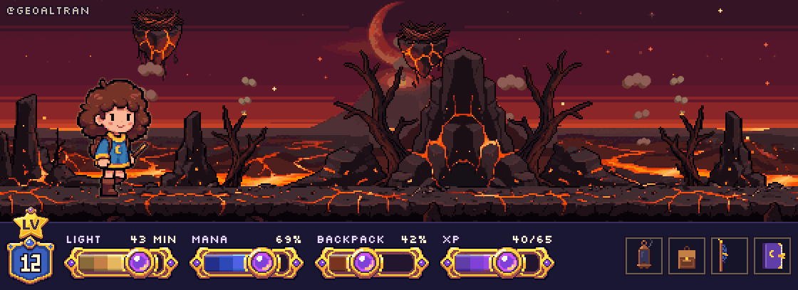

**English** · [Português](README.pt-BR.md) · [Español](README.es.md) · [Français](README.fr.md) · [Deutsch](README.de.md) · [中文](README.zh-CN.md) · [日本語](README.ja.md) · [한국어](README.ko.md)

<p align="center"></p>

# 🌙 The Chronicles of Lua · *As Crônicas de Lua*

A pixel-art RPG mod for Claude Code. Every tool call is a monster, your context window is a backpack, your rate limit is mana, and Lua, a tiny moon mage, fights them all while Claude works. Boss fights, XP, levels and a bestiary. You're technically still coding.



## What it is
A band right above the message box. While Claude works, Lua walks through a forest in parallax; every time Claude uses a tool, a monster shows up and she fights it. Behind the game, the band is an honest dashboard of your session: how warm the prompt cache is, how much of your plan limit is left, and how full the context window is.


## Install
In a Claude Code session, type:

```text
/plugin install cronicas-de-lua --marketplace geoaltran/cronicas-de-lua-claude-code
```

Answer `y` to add the marketplace, then pick a scope. The band appears above the message box.

Requires a recent Claude Code with mod support (built and tested on 2.1.330).

The mod runs two read-only commands on your machine, nothing else: `ps` (to notice when the app restarted, for the intro) and, on macOS, `defaults read -g AppleLanguages` (your system language).

## Where it runs
| Surface | What you get |
|---|---|
| **Claude desktop app (Code tab)** | The full game: animated scene, hover tooltips, clickable pixel-art buttons, the Book panel. |
| **VS Code** | The same animated scene; the buttons are a row below it (VS Code has no hover inside the drawing). |
| **Terminal** | A compact text version with colored bars and emojis. |
| **Mobile app** | Not yet: the app does not draw mod bands over Remote Control today. |

## The bars
| Bar | Means |
|---|---|
| **Moonlight** (pale gold) | How warm the prompt cache still is (time since the last reply vs. the cache lifetime). A moon in the sky wanes with it. **New moon** = Lua faints and the next message costs more (the cache is cold). |
| **Star Mana** | What is left of your plan's 5-hour limit (the 7-day one in the tooltip). |
| **Backpack** | How much of the context window is used. Above 80% the backpack shakes and suggests packing (compacting). |
| **XP / Level** | Grows as you work. Every 2 levels Lua's wand and outfit get a little shinier. |

## The buttons
| Button | Does |
|---|---|
| 🏮&nbsp;**Vigil** | Keeps the cache warm by sending a tiny message just before the moonlight runs out (at most 6 times, only while you are away). **Off by default: it spends your plan limit.** |
| 🎒&nbsp;**Backpack** | Offers to compact the conversation (like `/compact`), with a confirmation. |
| 🚩&nbsp;**Banner** | Asks Claude to write a mission summary so you can continue in a new session. |
| 📖&nbsp;**Book** | Opens Lua's Book: her sheet, the bestiary of defeated bosses, the trophy shelf and the grimoire (Claude's tools as spells). |


## What happens in the game
| Real event | In the game |
|---|---|
| Idle, between tasks | Lua walks, or stands breathing and blinking |
| A tool starts | A monster enters, "!" over Lua, she casts a star |
| The tool succeeds | Hit pause, the monster flashes, recoils, bursts into stars; damage number |
| A slow tool | Lua channels with a magic circle at her feet |
| The tool fails | The monster counter-attacks; Lua blinks red (visual only) |
| An error fixed later | Elite (Obsidian Golem); its fall leaves a trophy for the shelf |
| A task list is created, or every 12 fights | **Boss**: life in blocks, one per task. Ordinary hits bounce off its **shield** (Lua scratches her head ❓💧); a finished task drops a block; the last one is a **CRITICAL** hit. The boss falls with a recovered page (x/10) and a level up |


Monsters by tool: reading files → Vespera · editing code → Clockmaker / Sir Solis · terminal → Ignis · web → Leviathan / Nébula · integrations (MCP) → Mirror King · subagents → clones of Lady Penumbra. The bosses come in order, one page of the Chronicles each, up to Malakor, then New Game+.

## Commands
Type them in Claude's message box, like a normal message. The answer shows up only for you: Claude receives nothing and no plan limit is spent. Every subcommand also answers to its Portuguese name (`regua`, `largura`, `chefao`, `golpe`…).

| Command | What it does |
|---|---|
| <code>/cronicas</code> | Lua's summary: level, XP, recovered pages (x/10), latest trophies and the band settings. It also lists every command. |
| <code>/cronicas&nbsp;language&nbsp;[code]</code> | Lists the game's languages or switches to one: `en`, `pt-BR`, `es`, `fr`, `de`, `zh`, `ja`, `ko` (`auto` goes back to the system language). |
| <code>/cronicas&nbsp;ruler</code> | Shows a ruler under the scene to measure the band. Type it again to hide it. |
| <code>/cronicas&nbsp;width&nbsp;&lt;px&gt;</code> | Calibrates the width with the last whole number at the ruler's right edge (e.g. `/cronicas width 752`). |
| <code>/cronicas&nbsp;scale&nbsp;1&#124;2&#124;3</code> | Pixel size of the scene: 1x, 2x or 3x. |
| <code>/cronicas&nbsp;intro</code> | Plays the opening now (a click skips it). `intro off` / `intro on` turns the automatic one (first session of the day) off or on. |
| <code>/cronicas&nbsp;surfaces</code> | Tells where this session is being drawn (desktop app, VS Code, terminal, phone). |
| <code>/cronicas&nbsp;boss&nbsp;[name]</code> | Calls the next boss of the journey, or a chosen one (`vespera`, `ignis`, `malakor`…). `/cronicas boss list` calls a task-list boss with a shield. |
| <code>/cronicas&nbsp;hit</code> | Hits the boss on stage; against a task-list boss it completes a task. The last hit is the critical one. |
| <code>/cronicas&nbsp;elite</code> | The next regular fight becomes the elite (Obsidian Golem) carrying a trophy. |
| <code>/cronicas&nbsp;vigil</code> | Brings the moonlight close to its end so you can watch the Vigil work (with the lantern lit it sends a real, tiny message). |
| <code>/cronicas&nbsp;new-moon</code> | Simulates the new moon (cold cache) until Claude's next reply. |

⚠️ The test commands (`boss`, `hit`, `elite`) count for real: a boss beaten this way also gives back a page and a level.

The game speaks English, Portuguese, Spanish, French, German, Chinese, Japanese and Korean (it follows your system language; `/cronicas language` switches it).

## License
- **Code** (Python scripts, `mod/`): **MIT**, see [`LICENSE`](LICENSE).
- **Art and characters** (everything in `assets/`, the art embedded in the mod, the sounds and the previews): **© 2026 George Altran (@geoaltran), [CC BY-NC 4.0](LICENSE-ART)**. Share it, remix it, make fan art: just credit **"Art by George Altran (@geoaltran)"** with a link. **No commercial use** without permission; a commercial license is available on request.
- **Fonts**: Silkscreen, Pixelify Sans and Fusion Pixel Font (Chinese, Japanese and Korean), **SIL Open Font License 1.1** (license files next to them).

Full credits in [`CREDITS.md`](CREDITS.md).
