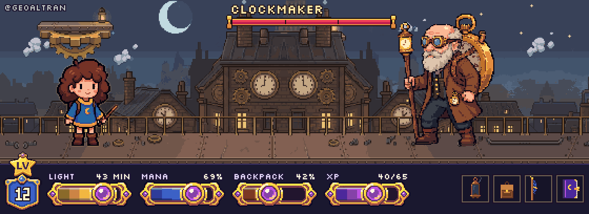
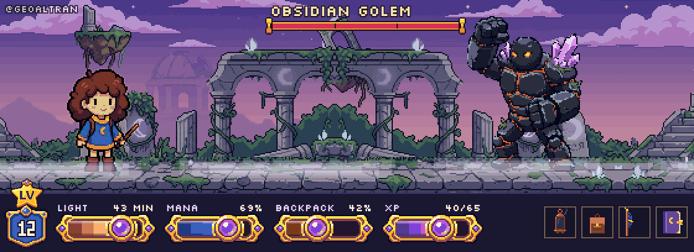
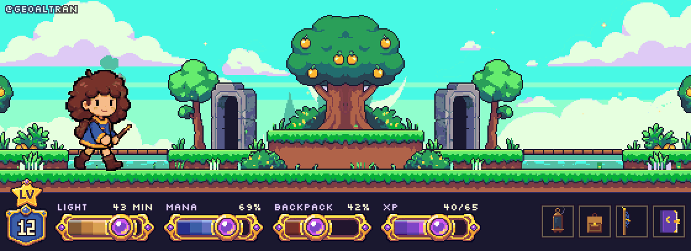
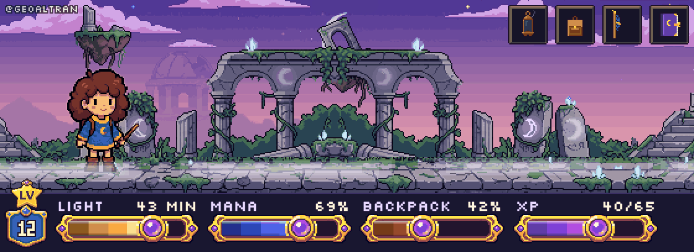

**English** · [Português](README.pt-BR.md) · [Español](README.es.md) · [Français](README.fr.md) · [Deutsch](README.de.md) · [中文](README.zh-CN.md) · [日本語](README.ja.md) · [한국어](README.ko.md)

<p align="center"></p>

# 🌙 The Chronicles of Lua · *As Crônicas de Lua*

<p align="center"><b>Claude Code, but it's an RPG.</b><br>Every tool call is a monster. Your to-do list is a boss fight. You're technically still coding.</p>

<p align="center">
  <a href="https://github.com/geoaltran/cronicas-de-lua-claude-code/blob/main/CHANGELOG.md"></a>
  <a href="https://github.com/geoaltran/cronicas-de-lua-claude-code/stargazers"></a>
  
  
  
</p>

<p align="center"><a href="#install">Install</a> · <a href="#commands">Commands</a> · <a href="CHANGELOG.md">Changelog</a> · <a href="https://github.com/geoaltran/cronicas-de-lua-claude-code/issues/new?title=Idea:%20">Suggest a boss or a biome</a> · <a href="https://github.com/geoaltran/cronicas-de-lua-claude-code/issues/new?title=Bug:%20">Report a bug</a></p>



Lua is a tiny moon mage who lives right above your message box. When Claude reads files she fights a Vespera, when it edits code the Clockmaker shows up, a long command makes her channel a spell, and a failed tool knocks her back. Create a to-do list and a boss appears: every finished task breaks a block of its health, and the last one is a **critical hit**. A little adventure for the minutes you spend waiting on Claude.

- **Every tool call is a fight**: reading, editing, the terminal, the web, MCP and subagents each bring their own monster.
- **To-do lists are boss fights**: 10 bosses with health in blocks, a shield and a critical hit.
- **9 parallax biomes**: one for each boss, from a moonlit sea to a volcano and an eclipse.
- **An honest HUD**: moonlight is your prompt cache, mana is your plan limit, the backpack is your context window.
- **XP, levels and Lua's Book**: a bestiary, a trophy shelf (fixed errors become trophies) and a grimoire of Claude's tools.
- **8 languages**: English, Português, Español, Français, Deutsch, 中文, 日本語, 한국어.

## What it is
A band right above the message box. While Claude works, Lua travels through 9 parallax biomes; every time Claude uses a tool, a monster shows up and she fights it. Behind the game, the band is an honest dashboard of your session: how warm the prompt cache is, how much of your plan limit is left, and how full the context window is.


## Install
In a Claude Code session, type:

```text
/plugin install cronicas-de-lua --marketplace geoaltran/cronicas-de-lua-claude-code
```

Answer `y` to add the marketplace, then pick a scope. The band appears above the message box.

Requires a recent Claude Code with mod support (built and tested on 2.1.331).

The mod runs two read-only commands on your machine, nothing else: `ps` (to notice when the app restarted, for the intro) and, on macOS, `defaults read -g AppleLanguages` (your system language).

**Updates.** Once a day, in the first session, the mod also reads the version number published in this repository (a public file on GitHub). Nothing about you or your conversations is sent, and nothing is downloaded or installed on its own. When a new version is out, the Book button gets a little star and its balloon tells you; to update, type `/plugin marketplace update cronicas-de-lua`, then `/plugin update cronicas-de-lua@cronicas-de-lua` (in the desktop app, where `/plugin` only opens the plugins window, run `claude plugin marketplace update cronicas-de-lua` and `claude plugin update cronicas-de-lua@cronicas-de-lua` in the Terminal instead), and open a new session. `/cronicas updates off` turns the check off (it also stays off when `CLAUDE_CODE_DISABLE_NONESSENTIAL_TRAFFIC` is set). If you'd rather have updates arrive by themselves, Claude Code has its own auto-update option for marketplaces.

## Where it runs
| Surface | What you get |
|---|---|
| **Claude desktop app (Code tab)** | The full game: animated scene, hover tooltips, clickable pixel-art buttons, the Book panel. |
| **VS Code** | The same animated scene; the buttons are a row below it (VS Code has no hover inside the drawing). |
| **Terminal** | A compact text version with colored bars and emojis. |
| **Mobile app** | Not yet: the app does not draw mod bands over Remote Control today. |

## The bars
| Bar | Means |
|---|---|
| **Moonlight** (pale gold) | How warm the prompt cache still is (time since the last reply vs. the cache lifetime). A moon in the sky wanes with it. **New moon** = Lua falls asleep and the next message costs more (the cache is cold). |
| **Star Mana** | What is left of your plan's 5-hour limit (the 7-day one in the tooltip). |
| **Backpack** | How much of the context window is used. Above 80% the backpack shakes and suggests packing (compacting). |
| **XP / Level** | Grows as you work. Every 2 levels Lua's wand and outfit get a little shinier. |

## The buttons
| Button | Does |
|---|---|
| 🏮&nbsp;**Vigil** | Keeps the cache warm by sending a tiny message just before the moonlight runs out (at most 6 times, only while you are away). **Off by default: it spends your plan limit.** |
| 🎒&nbsp;**Backpack** | Offers to compact the conversation (like `/compact`), with a confirmation. |
| 🚩&nbsp;**Banner** | Asks Claude to write a mission summary so you can continue in a new session. |
| 📖&nbsp;**Book** | Opens Lua's Book: her sheet, the journey map (the biomes she has visited), the bestiary of defeated bosses, the trophy shelf and the grimoire (Claude's tools as spells), plus a Commands page listing every `/cronicas` command, with a link to their explanation here. When a new version is out, a little star shines on the Book and the Commands page shows how to update. |


## What happens in the game
| Real event | In the game |
|---|---|
| Idle, between tasks | Lua walks, or stands breathing and blinking |
| A tool starts | A monster enters, "!" over Lua, she casts a star |
| The tool succeeds | Hit pause, the monster flashes, recoils, bursts into stars; damage number |
| A slow tool | Lua channels with a magic circle at her feet |
| The tool fails | The monster counter-attacks; Lua blinks red (visual only) |
| An error fixed later | Elite (Obsidian Golem); its fall leaves a trophy for the shelf |
| A task list is created, or every 12 fights | **Boss**: life in blocks, one per task. Ordinary hits bounce off its **shield** (Lua scratches her head ❓💧); a finished task drops a block; the last one is a **CRITICAL** hit. The boss falls with a recovered page (x/10) and a level up, and Lua moves on to the next biome |




Monsters by tool: reading files → Vespera · editing code → Clockmaker / Sir Solis · terminal → Ignis · web → Leviathan / Nébula · integrations (MCP) → Mirror King · subagents → clones of Lady Penumbra. The bosses come in order, one page of the Chronicles each, up to Malakor, then New Game+. Now and then (about 1 regular fight in 4) the boss of the current page steps in instead, a preview of what is coming.

## The biomes
Lunária has 9 biomes, one for each stretch of the journey, each at its own time of day and with its own animations: Forest (Vespera and Lady Penumbra), Ruins (Obsidian Golem), Sea (Leviathan), Volcano (Ignis), Clock Tower (Clockmaker), Dawn (Sir Solis), Glass Castle (Mirror King), Starry Sky (Nébula) and Eclipse (Malakor). Waves and a turning lighthouse, pulsing lava, spinning gears, sunbeams, reflections running across mirrors, shooting stars, and particles of their own in every place.



When a biome's boss falls, a **stage transition** follows: Lua walks off the edge, the screen fades to black and she walks into the next biome under a pixel-art page title.



## Commands
Type them in Claude's message box, like a normal message. The answer shows up only for you: Claude receives nothing and no plan limit is spent. Every subcommand also answers to its Portuguese name (`regua`, `largura`, `chefao`, `golpe`…).

| Command | What it does |
|---|---|
| <code>/cronicas</code> | Lua's summary: level, XP, recovered pages (x/10), latest trophies and the band settings. It also lists every command. |
| <code>/cronicas&nbsp;language&nbsp;[code]</code> | Lists the game's languages or switches to one: `en`, `pt-BR`, `es`, `fr`, `de`, `zh`, `ja`, `ko` (`auto` goes back to the system language). |
| <code>/cronicas&nbsp;updates&nbsp;[check&#124;off&#124;on]</code> | Shows your version and whether a new one is out, with how to update. `check` checks now; `off` / `on` turns the daily check off or on. |
| <code>/cronicas&nbsp;ruler</code> | Shows a ruler under the scene to measure the band. Type it again to hide it. |
| <code>/cronicas&nbsp;width&nbsp;&lt;px&gt;</code> | Calibrates the width with the last whole number at the ruler's right edge (e.g. `/cronicas width 752`). |
| <code>/cronicas&nbsp;scale&nbsp;1&#124;2&#124;3</code> | Pixel size of the scene: 1x, 2x or 3x. |
| <code>/cronicas&nbsp;intro</code> | Plays the opening now (a click skips it). `intro off` / `intro on` turns the automatic one (first session of the day) off or on. |
| <code>/cronicas&nbsp;surfaces</code> | Tells where this session is being drawn (desktop app, VS Code, terminal, phone). |
| <code>/cronicas&nbsp;boss&nbsp;[name]</code> | Calls the next boss of the journey, or a chosen one (`vespera`, `ignis`, `malakor`…), and the scene moves to its biome. `/cronicas boss list` calls a task-list boss with a shield. |
| <code>/cronicas&nbsp;hit</code> | Hits the boss on stage; against a task-list boss it completes a task. The last hit is the critical one. |
| <code>/cronicas&nbsp;elite</code> | The next regular fight becomes the elite (Obsidian Golem) carrying a trophy. |
| <code>/cronicas&nbsp;walk&nbsp;[seconds]</code> | Lua walks through the current biome for a few seconds (8 by default, up to 120) so you can watch the layers scroll in a loop, then stops and breathes. |
| <code>/cronicas&nbsp;stage&nbsp;[biome]</code> | A stage change just for sightseeing: Lua walks off, the next biome (or the one you name: `sea`, `volcano`, `eclipse`…) fades in with its title and she walks back in. No page is counted. |
| <code>/cronicas&nbsp;vigil</code> | Brings the moonlight close to its end so you can watch the Vigil work (with the lantern lit it sends a real, tiny message). |
| <code>/cronicas&nbsp;new-moon</code> | Simulates the new moon (cold cache) until Claude's next reply. |

⚠️ The test commands (`boss`, `hit`, `elite`) count for real: a boss beaten this way also gives back a page and a level.

The game speaks English, Portuguese, Spanish, French, German, Chinese, Japanese and Korean (it follows your system language; `/cronicas language` switches it).

## License
- **Code** (Python scripts, `mod/`): **MIT**, see [`LICENSE`](LICENSE).
- **Art and characters** (everything in `assets/`, the art embedded in the mod, the sounds and the previews): **© 2026 George Altran (@geoaltran), [CC BY-NC 4.0](LICENSE-ART)**. Share it, remix it, make fan art: just credit **"Art by George Altran (@geoaltran)"** with a link. **No commercial use** without permission; a commercial license is available on request.
- **Fonts**: Silkscreen, Pixelify Sans and Fusion Pixel Font (Chinese, Japanese and Korean), **SIL Open Font License 1.1** (license files next to them).

Full credits in [`CREDITS.md`](CREDITS.md).
