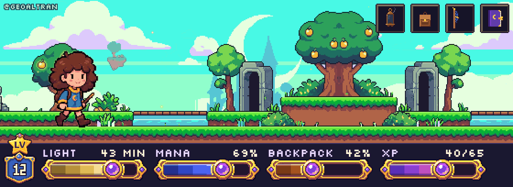
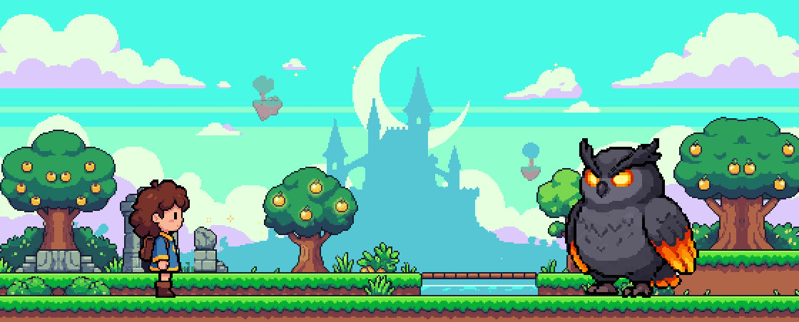

[English](README.md) · **Português** · *Español, Français, Deutsch, 中文, 日本語, 한국어: em breve*

# 🌙 As Crônicas de Lua

Um mod de RPG em pixel art para o Claude Code. Cada ferramenta é um monstro, a janela de contexto é uma mochila, o limite do plano é mana, e a Lua, uma pequena maga da lua, enfrenta todos enquanto o Claude trabalha. Chefões, XP, níveis e um bestiário. Tecnicamente, você continua programando.


## O que é
Uma faixa logo acima da caixa de mensagem. Enquanto o Claude trabalha, a Lua anda por uma floresta em parallax; cada vez que o Claude usa uma ferramenta, um monstro aparece e ela luta. Por trás do jogo, a faixa é um painel honesto da sua sessão: o quanto o cache da conversa ainda está quente, quanto resta do limite do plano e o quanto a janela de contexto já encheu.



## Instalar
Numa sessão do Claude Code, digite:

```text
/plugin install cronicas-de-lua --marketplace geoaltran/cronicas-de-lua-claude-code
```

Responda `y` para adicionar o marketplace e escolha onde instalar. A faixa aparece acima da caixa de mensagem.

Precisa de um Claude Code recente, com suporte a mods (feito e testado na 2.1.330).

## Onde funciona
| Lugar | O que aparece |
|---|---|
| **App desktop do Claude (aba Code)** | O jogo completo: cena animada, balões no hover, botões em pixel art clicáveis, o painel do Livro. |
| **VS Code** | A mesma cena animada; os botões ficam numa linha embaixo (o VS Code não tem hover dentro do desenho). |
| **Terminal** | Uma versão compacta em texto, com barras coloridas e emojis. |
| **App do celular** | Ainda não: hoje o app não desenha a faixa dos mods pelo Remote Control. |

## As barras
| Barra | Significa |
|---|---|
| **Luz da Lua** (dourado pálido) | O quanto o cache da conversa ainda está quente (tempo desde a última resposta x a duração do cache). Uma lua no céu mingua junto. **Lua nova** = a Lua desmaia e a próxima mensagem sai mais cara (o cache esfriou). |
| **Mana Estelar** | O que resta do limite de 5 h do plano (o de 7 dias no balão). |
| **Mochila** | Quanto da janela de contexto já foi usado. Acima de 80% a mochila treme e sugere arrumar (compactar). |
| **XP / Nível** | Sobe com o uso. A cada 2 níveis a varinha e a roupa da Lua brilham um pouco mais. |

## Os botões
| Botão | Faz |
|---|---|
| 🏮 **Vigília** | Mantém o cache quente mandando uma mensagem curtinha pouco antes de o luar acabar (no máximo 6 vezes, só enquanto você está fora). **Começa desligada: gasta o limite do plano.** |
| 🎒 **Mochila** | Oferece compactar a conversa (como o `/compact`), com confirmação. |
| 🚩 **Estandarte** | Pede ao Claude um resumo da missão para continuar numa sessão nova. |
| 📖 **Livro** | Abre o Livro da Lua: a ficha dela, o bestiário dos chefões derrotados, a estante de troféus e o grimório (as ferramentas do Claude como feitiços). |

## O que acontece no jogo
| Evento real | No jogo |
|---|---|
| Ocioso, entre tarefas | A Lua anda, ou fica parada respirando e piscando |
| Uma ferramenta começa | Um monstro entra, "!" sobre a Lua, ela lança uma estrela |
| A ferramenta dá certo | Pausa de impacto, o monstro pisca, recua e explode em estrelinhas; número de dano |
| Ferramenta demorada | A Lua canaliza com um círculo mágico aos pés |
| A ferramenta dá erro | O monstro contra-ataca; a Lua pisca vermelho (só visual) |
| Um erro consertado depois | Elite (Golem de Obsidiana); quando cai, deixa um troféu para a estante |
| Lista de tarefas criada, ou a cada 12 lutas | **Chefão**: vida em blocos, um por tarefa. Golpes comuns batem no **escudo** (a Lua coça a cabeça ❓💧); tarefa concluída derruba um bloco; a última é o golpe **CRÍTICO**. O chefão cai com uma página recuperada (x/10) e um nível a mais |



Monstros por ferramenta: ler arquivos → Vespera · editar código → Relojoeiro / Sir Solis · terminal → Ignis · web → Leviatã / Nébula · integrações (MCP) → Rei Espelho · subagentes → clones da Dama Penumbra. Os chefões vêm em ordem, uma página das Crônicas cada, até o Malakor; depois, Novo Jogo+.

## Comandos
`/cronicas` mostra o resumo da Lua. Os úteis: `/cronicas regua` e `/cronicas largura <px>` (calibram a largura), `/cronicas chefao` e `/cronicas golpe` (testam uma luta de chefão), `/cronicas superficies` (onde a sessão está desenhando). A lista completa está em [`COMANDOS_CRONICAS.md`](COMANDOS_CRONICAS.md).

## Licença
- **Código** (scripts Python, `mod/`): **MIT**, ver [`LICENSE`](LICENSE).
- **Arte e personagens** (tudo em `assets/`, a arte embutida no mod, os sons e as prévias): **© 2026 George Altran (@geoaltran), [CC BY-NC 4.0](LICENSE-ART)**. Compartilhe, faça remix, fan art: só dê o crédito **"Arte de George Altran (@geoaltran)"** com o link. **Uso comercial só com autorização**; licença comercial sob consulta. O texto legal que vale é o da Creative Commons, em inglês.
- **Fontes**: Silkscreen e Pixelify Sans, **SIL Open Font License 1.1** (as licenças ficam junto delas).

Créditos completos em [`CREDITS.md`](CREDITS.md).
